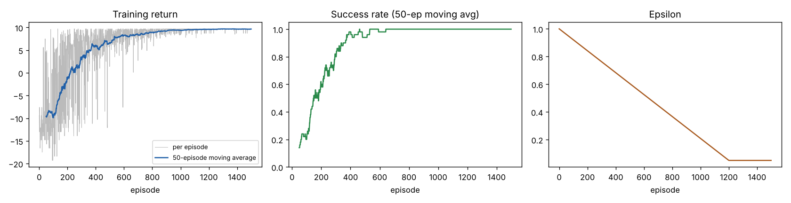
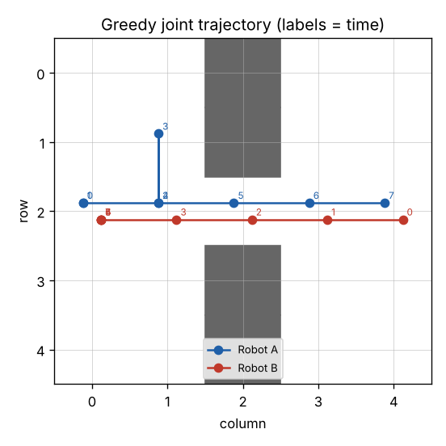

# Laboratory Report — Reinforcement Learning and Deep RL

**Robots in a Warehouse** · Artificial Intelligence (CS F407)

| File | Purpose |
|------|---------|
| `warehouse_env.py` | single- and two-robot environments, `propose()` movement rule, one-hot encodings, test mode (`set_position` / `set_state`) |
| `q_learning.py` | Part I: tabular Q-learning, greedy evaluation, random-policy baseline, plots |
| `dqn.py` | Parts II–III: DQN (replay buffer, target network) for one and two robots |
| `test_rl.py` | environment, TD-update, DQN-loss and collision-rule tests (run before training) |
| `qlearning_training.png` | training return / success / epsilon curves |
| `two_robot_trajectory_seed7_60k.png`, `…_120k.png` | greedy two-robot trajectories with time labels |
| `*_transcript.txt`, `test_output.txt`, `seed_sweep.txt` | captured output |

**Reproducibility.** Python 3.13, NumPy 2.5, PyTorch 2.15 (CPU), Matplotlib 3.11. Seed 7 unless stated.

```bash
python3 test_rl.py        # all tests; run these first
python3 q_learning.py     # Part I   (about 2 s)
python3 dqn.py            # Parts II and III  (about 1 min on CPU)
```

---

## Part I — Tabular Q-learning

### Task 1 — The MDP

| Component | Specification |
|---|---|
| **State** | the robot's cell `(r,c)`, one of the 21 free cells of the 5×5 grid |
| **Actions** | `0 Up, 1 Down, 2 Left, 3 Right, 4 Wait` |
| **Transition rule** | deterministic: `(r,c) → (r+dr, c+dc)`; a move into an obstacle `{(0,2),(1,2),(3,2),(4,2)}` or off the grid leaves the robot in place; Wait stays |
| **Reward** | mutually exclusive: `+10` on reaching the goal; `−1` for an obstacle or boundary move; `−0.1` for any other valid action including Wait. γ = 0.95 |
| **Initial state** | `S = (2,0)` |
| **Terminal outcome** | reaching `G = (2,4)` terminates. The 40-step cutoff is *truncation*, not termination |

(a) **Information needed for the state:** only the robot's position.
(b) **Why position is enough:** the map, goal and rewards are fixed and do not change over time, so the future (next positions and rewards) depends only on the current cell and the action. That is the Markov property. Time is not part of the task because the 40-step cutoff is a data-collection limit, not a deadline in the task.
(c) **Deterministic?** Yes. Each (state, action) pair has exactly one next state and reward.
(d) **Shortest route:** `(2,0) → (2,1) → (2,2) → (2,3) → (2,4)`, which is 4 Right moves straight through the doorway.
(e) **Is finding that route by search the same as learning action values?** No. Search uses the known model (transition rule and goal) to plan a path without acting. Q-learning is not given the model or any path. It estimates `Q(s,a)` from sampled experience `(s,a,r,s')` and the reward signal, and the route only emerges as the greedy policy of those estimates. Both reach the same route here, by different processes.

### Task 2 — Design

1. **Grid and position:** obstacles in a `frozenset`; position as a tuple `(r,c)`.
2. **`reset()`** returns the start cell and resets the step counter. **`step(a)`** returns `(next_state, reward, terminated, truncated, info)`, with `info["invalid"]` set for blocked moves.
3. **Q-table:** NumPy array of shape 25×5, row `5r+c`. Obstacle rows are unused.
4. **Epsilon-greedy:** with probability ε choose uniformly from 5 actions; otherwise pick an argmax action, breaking ties **randomly** during training.
5. **Terminal flag in the target:** `y = r` if `terminated`, else `y = r + γ max_a' Q(s',a')`. Truncation still bootstraps.
6. **Episode stops** on termination or after 40 steps (truncation). The update uses the next state returned by `step`, *before* `reset` is called.
7. **Training vs evaluation:** training uses ε-greedy and updates Q. Evaluation uses ε = 0, **no updates**, and a fixed tie-break (lowest action code, `np.argmax`).

**Recorded:** per-episode return, goal reached, ε, invalid moves; final greedy trajectory, length, invalid moves, success or timeout.

### Task 3 — Prompt and how the LLM was used

The LLM used was **Claude** (Anthropic). It was given the full lab handout (the PDF) and asked to solve the lab completely. The MDP formulation and design above, all the code in this folder, the tests and the first draft of this report came from that session. The code implements every constraint in the handout's example prompt: the exact map and coordinates, action codes, mutually exclusive rewards, α=0.2, γ=0.95, a zero-initialised Q-table, seed 7, 1,500 episodes, ε linear 1→0.05 over 1,200 episodes, a 40-step cutoff, separate termination and truncation flags, bootstrapping at truncation but not at goal termination, the next state taken before reset, no path search, no RL library, and a test mode for setting the robot's position.

**Corrections to the generated code:** none were needed for Part I. The code was checked against the rules that are easiest to get wrong, and all were already right: `terminated` and `truncated` are separate flags, and only `terminated` drops the bootstrap term; training breaks ties *randomly* while evaluation uses a fixed rule (`np.argmax`); and `set_position()` allows testing without a learner. Task 4 below shows the evidence.

### Task 4 — Testing the environment and the update

Environment (`test_rl.py`, all passed):

| Position | Action | Expected | Observed |
|---|---|---|---|
| (0,0) | up | stay, −1, no termination | ✓ |
| (1,1) | right | stay (obstacle), −1, no termination | ✓ |
| (2,1) | right | move to (2,2), −0.1 | ✓ |
| (2,1) | wait | stay, −0.1 | ✓ |
| (2,3) | right | reach (2,4), +10, terminate | ✓ |
| — | 40 × wait | truncated after exactly 40 steps, not terminated | ✓ |

Synthetic Q-learning updates with `Q(s,a)=0.4, max Q(s',·)=2, α=0.2, γ=0.95`:

| Case | Target y (by hand) | Updated Q(s,a) (by hand) | Program |
|---|---|---|---|
| non-terminal, r=1 | 1 + 0.95·2 = **2.9** | 0.4 + 0.2·(2.9−0.4) = **0.9** | 0.9 ✓ |
| true termination, r=5 | **5** | 0.4 + 0.2·(5−0.4) = **1.32** | 1.32 ✓ |
| truncated, r=1 | **2.9** (still bootstraps) | **0.9** | 0.9 ✓ |

**Only true termination ignores the next-state value.** Truncation only means we stopped collecting data; the robot could have kept going, so the future value is real and must be bootstrapped.

| Concept | Where in the program |
|---|---|
| State and action representation | `warehouse_env.index()` (5r+c), `ACTIONS`, `DELTAS` |
| Reward and termination | `SingleRobotEnv.step()`, using `propose()` |
| Epsilon-greedy action choice | `q_learning.epsilon_greedy()`, `epsilon_at()` |
| TD target and Q-table update | `q_learning.td_target()`, `q_update()` |
| Training and greedy evaluation | `q_learning.train()`, `greedy_rollout()` |

### Task 5 — Training, evaluation, exploration



Moving-average window: **50 episodes**. The goal was first reached in episode 29. Training success reaches 1.0 by about episode 500, and over the last 100 episodes the mean return is 9.65 (close to the optimum `−0.1·3 + 10 = 9.7`).

**Greedy evaluation** (ε = 0, no updates): `Right, Right, Right, Right`, positions `(2,0)→(2,1)→(2,2)→(2,3)→(2,4)`, **4 steps**. This is the shortest route from Task 1.

```
. . # . .
. . # . .
R R R R R
. . # . .
. . # . .
```

| Measure | Random policy (100 episodes) | Greedy Q-policy (default start) |
|---|---|---|
| Goal reached | 18 / 100 (0.18) | yes |
| Steps to goal, if successful | mean 26.9 | 4 |
| Timeouts | 82 / 100 (0.82) | 0 |
| Invalid moves | 9.86 per episode on average | 0 |

(a) **Why the training curve stays noisy after a good route is learned:** training still explores. With ε = 0.05 roughly one action in twenty is random, which sometimes causes a wall bump (−1) or an extra step, and the curve plots these exploratory episodes, not the greedy policy. Early on, Q-values are also still changing.
(b) **Does a high training return imply a good greedy policy?** Not necessarily. Training return measures the ε-greedy behaviour policy, which can be helped or hurt by randomness, and the greedy policy can differ in states that are rarely visited. The two-robot runs show this directly: seed 1 at 60k steps had 70 % training success yet its greedy rollout timed out. The greedy policy must be evaluated separately.
(c) **α vs ε:** α is the learning rate, i.e. how far `Q(s,a)` moves toward the new target in each update (it affects *learning*). ε is the exploration probability, i.e. how often a random action is taken instead of the greedy one (it affects *behaviour and data collection*).

**Optional, no exploration (ε = 0 throughout).** With seeds 7 and 11 the fresh Q-table still learned the 4-step route (1,497/1,500 training successes). This does not mean exploration is unnecessary. Here, zero initialisation combined with negative step rewards makes every *untried* action look better than tried ones (0 > −0.1), so greedy selection with random tie-breaking explores on its own. With a different initialisation or reward scale, pure greedy learning can get stuck.

---

## Part II — Task 6: DQN for one robot

**What changes and what stays the same.** The environment, rewards, start, goal, γ and the termination/truncation logic stay the same. What changes: Q(s,·) is produced by a network `25 one-hot → 64 ReLU → 64 ReLU → 5 linear`, not read from a table; learning uses minibatches drawn from a replay buffer, targets come from a periodically synchronised target network, and the update is a gradient step on a squared TD error rather than a table assignment.

**Settings:** replay 20,000; batch 64; 500 warm-up steps; one Adam (lr 1e-3) update every 4 environment steps; target sync every 250 updates; ε linear 1→0.05 over the first 80 % of 12,000 steps; seed 7.

**Loss tests before training** (`test_rl.py`, all passed), with a target network whose maximum next value is 2:

| Case | Expected target | Observed |
|---|---|---|
| non-terminal, r=1 | 2.9 | 2.9 ✓ |
| terminal, r=5 | 5 | 5 ✓ |
| truncated, r=1 (d=0) | 2.9 | 2.9 ✓ |

The loss compares each target with `Q_θ(s, a)` for the **recorded action**, selected with `online(s).gather(1, a)`. The target is computed under `torch.no_grad()`, carries no gradient, and gradients reach only the online network.

| Component | Location in `dqn.py` |
|---|---|
| Replay buffer | `ReplayBuffer.push()` |
| Batch sampling | `ReplayBuffer.sample()`, uniform random |
| TD target | `dqn_loss()`: `y = r + γ(1−d)·max target(s′)` in `torch.no_grad()` |
| Recorded action selected | `online(s).gather(1, a.unsqueeze(1))` in `dqn_loss()` |
| Optimiser step | `train_dqn()`: `loss.backward(); opt.step()` every 4 env steps after warm-up |
| Target-network sync | `train_dqn()`: `target.load_state_dict(online.state_dict())` every 250 updates |

**Result:** 2,875 optimiser updates over 1,182 episodes. The greedy route from (2,0) is `Right ×4`, **4 steps**, 0 invalid moves, identical to the Q-table route. The training success rate over the last 50 episodes rose from 0.32 (step 3k) to 1.00 (step 9k). As the lab notes, the training budgets differ, so this does not show which method is more sample-efficient; on a 21-state problem the table is the natural choice.

---

## Part III — Task 7: Two robots

### Controller design

(a) **Why A's position alone is insufficient:** the reward, the collisions and the right action for A all depend on where B is. With only A's position the problem is no longer Markov: the same observation could require "go through the door" or "step aside".
(b) **Representation:** state = ordered pair `(p_A, p_B)`, encoded as two concatenated length-25 one-hots (50 inputs).
(c) **Joint actions:** 5 × 5 = **25**, encoded `j = 5a_A + a_B`, decoded with `divmod(j, 5)`.
(d) **A collision-free route** (and the one the agent learned; a BFS over joint states with the same rules confirms 7 joint steps is the minimum):

```
t  A      B
0  (2,0)  (2,4)
1  (2,0)  (2,3)    A waits, B advances
2  (2,1)  (2,2)    B enters the doorway
3  (1,1)  (2,1)    A steps up and aside; B follows into the cell A vacated
4  (2,1)  (2,0)    B arrives home; A steps back down
5  (2,2)  (2,0)
6  (2,3)  (2,0)
7  (2,4)  (2,0)    A arrives -> both done
```

(e) **Where a robot must yield:** the doorway (2,2) is a one-cell corridor, and both robots start on the shared row-2 line. One robot has to leave row 2, stepping into row 1 or 3 of its own room (for example A to (1,1) or (3,1)), to let the other pass. Otherwise they meet head-on, which is a same-cell or swap collision.

### Simultaneous movement and reward (implemented in `TwoRobotEnv.step`)

Both moves are computed from the same old state; obstacle or boundary moves become stays; a robot at its goal stays whatever it is asked to do. **Same-cell collision:** the proposed cells are equal. **Swap collision:** the robots exchange cells. Entering a waiting robot's cell is a collision; following into a cell just vacated is allowed. On collision the old positions are kept, `r = −10`, and the episode terminates. Otherwise `r = −0.1 − b + 5k + 5I`. The task terminates on collision or when both robots have arrived, and is truncated at 40 joint steps.

### Tests before training (predictions confirmed by `test_rl.py`)

| Old A, B | A | B | Prediction = observed |
|---|---|---|---|
| (2,1), (2,3) | right | left | both propose (2,2): **same-cell collision**, r = −10, terminate, positions unchanged |
| (2,1), (2,2) | right | left | A→(2,2), B→(2,1): **swap collision**, r = −10, terminate |
| (2,1), (2,2) | right | right | A follows B: A→(2,2), B→(2,3), no collision, r = −0.1 |
| (2,1), (2,2) | up | wait | A→(1,1), B stays, no collision, r = −0.1 |

Also verified: entering a waiting robot's cell is a collision; A arriving gives `−0.1 + 5 = 4.9`; once at its goal A ignores its action and gets no repeated arrival reward; the second arrival gives `−0.1 + 5 + 5 = 9.9` and terminates; two invalid moves give `−2.1`; and the encoding of all 25 joint actions round-trips.

### Results (DQN settings of Task 6; 50 inputs, 25 outputs)

**Seed 7, 60,000 steps (the lab's starting budget): failed.** Greedy rollout (see `dqn_transcript.txt` and `two_robot_trajectory_seed7_60k.png`): A moves *up* to (1,0) then (0,0) and gets out of the way, B drives straight home to (2,0) in 4 steps, and then **A waits at (0,0) for the remaining 36 steps → timeout**. There were no collisions and no invalid moves, but the delivery task failed. This is exactly the failure the lab warns about: a robot that waits forever avoids collisions while failing the task. The training log shows instability: success in the last 50 episodes peaked at 0.24 around 20k steps and fell to 0.00 by 50k. The policy found the safe "yield and get B's +5" behaviour but had not yet learned A's longer continuation.

**Retry with another seed and a larger budget** (`seed_sweep.txt`). At 60k steps, none of seeds 1, 2, 3, 11 succeeded from the default start. At **120,000 steps, seed 7 succeeded** (and seed 1 too, in 8 steps):

```
 t  A action B action A pos    B pos
 0  -        -        (2, 0)   (2, 4)
 1  Wait     Left     (2, 0)   (2, 3)
 2  Right    Left     (2, 1)   (2, 2)
 3  Up       Left     (1, 1)   (2, 1)
 4  Down     Left     (2, 1)   (2, 0)
 5  Right    Down     (2, 2)   (2, 0)     <- B is home; its actions are ignored
 6  Right    Up       (2, 3)   (2, 0)
 7  Right    Down     (2, 4)   (2, 0)
outcome = success, 7 steps (the minimum), 0 invalid moves, 0 collisions
```



(a) **Which robot entered the passage first?** **B**: it reached the doorway (2,2) at t=2.
(b) **Where did the other robot yield?** **A stepped up into (1,1)** at t=3, and B followed into (2,1), the cell A had just vacated (allowed: not a swap, final cells differ). A then came back down and went through the doorway.
(c) **Is avoiding collisions sufficient for success?** **No.** The 60k policy had zero collisions and still failed, because A never reached its goal. Success requires *both* robots at their goals before the cutoff.
(d) **Joint-action size for three robots:** `5³ = 125` outputs (and 75 one-hot inputs). In general it is `5ⁿ`, exponential in the number of robots.

---

## Task 8 — Evaluation of the three controllers (greedy, learning disabled)

| Measure | Q-table, one robot | DQN, one robot | DQN, two robots |
|---|---|---|---|
| Budget and seed | 1,500 episodes, seed 7 | 12,000 env steps, seed 7 | 60,000 steps, seed 7 → **failed**; 120,000 steps, seed 7 → succeeded |
| Success / collision / timeout | success | success | 60k: timeout (no collision); 120k: success |
| Steps, if successful | 4 (optimal) | 4 (optimal) | 7 (optimal joint plan) |
| Invalid moves | 0 | 0 | 0 |

**Additional starts, without retraining**

| Controller | Start | Result |
|---|---|---|
| Q-table | (0,0) | success, 6 steps (`Down, Down, Right×4`), which is the shortest possible |
| DQN, one robot | (0,0) | success, 6 steps via (0,1),(1,1),(2,1) |
| DQN, two robots (60k) | A (0,0), B (4,4) | timeout (B goes home, A stalls at (0,0)) |
| DQN, two robots (120k) | A (0,0), B (4,4) | success, 11 steps, no collisions |

**Interpretation.** These starts work partly by luck of coverage, not by design. The policies were trained only from the default start, but ε-greedy exploration visited the cells near (0,0) and the Q-values there happened to be sensible. That is not guaranteed: a state never visited during training keeps its initial Q-values (a table) or whatever the network extrapolates. Each row above is a *single* deterministic greedy rollout, and repeating it from the same start would give the same result, so it is one observation, not a success rate. Raw returns of the one- and two-robot tasks are not compared because their reward definitions differ.

### Reflection on the LLM's contribution

1. **Which parts of the design were specified before requesting code?** None by me separately: the whole lab handout was given to Claude, and the handout itself specifies the map, actions, rewards, termination and truncation rules, hyperparameters, network sizes, encodings and the two-robot collision and reward rules. Claude turned that into the MDP table and design in Tasks 1–2 and into the code in the same session. The specification that matters is therefore the handout's, and the tests check the code against it.
2. **Did the LLM change any rewards, stopping rules or algorithm details?** No change was found. Every rule the handout states precisely was tested directly against it and matched: the five environment cases, the 40-step truncation, the three hand-computed TD updates, the three DQN targets, the four two-robot predictions, entering a waiting robot's cell, the at-goal and arrival-reward rules, and the invalid-move penalty. The one place the code goes beyond the handout is `shortest_joint_plan()`, a BFS used *only afterwards* to confirm that 7 joint steps is optimal. It is never given to the learner, as the handout requires.
3. **Which errors did the tests reveal?** None in the code. What the experiments revealed was a **result** problem: with the handout's starting budget (60,000 steps, seed 7) the two-robot DQN failed. A yields and then waits forever while B goes home. The other seeds tried (1, 2, 3, 11) also failed from the default start at 60k (`seed_sweep.txt`).
4. **Did the code use a replay buffer and target network as requested?** Yes. This was confirmed in the code (see the Task 6 table) and by the loss test: targets are computed under `no_grad()` from a separate network that is synchronised every 250 updates, and the loss uses `Q(s, recorded action)`.
5. **Which generated functions can now be explained without consulting the LLM?** `propose`, both `step` methods (including both collision tests), `td_target`, `q_update`, `epsilon_greedy`, `dqn_loss` (the gather on the recorded action, the `(1−d)` mask, `no_grad`), and the training loop's warm-up, train-every-4 and sync-every-250 logic.
6. **What was changed, and what evidence shows the change was correct?** Only the two-robot **training budget**, following the handout's instruction to try another seed or a larger budget when a run fails. Doubling it to 120,000 steps made seed 7 succeed in 7 steps (and seed 1 in 8). The evidence is the greedy rollout itself (no collision, both robots arrive) together with the BFS check that 7 is the minimum. The failed 60k run is kept and reported rather than replaced.

---

## 8.1 (Optional) — Connection to RLHF

1. **Feedback people would provide:** pairwise *preferences* between two recorded trajectories, for example "trajectory 1 is better because the robots never pass within one cell of each other" or "trajectory 2 is better because A does not wait needlessly".
2. **What a learned reward model would predict:** a scalar score `r̂(trajectory)` (or a per-step reward) trained so that the preferred trajectory scores higher. A Bradley–Terry model gives `P(τ₁ ≻ τ₂) = σ(r̂(τ₁) − r̂(τ₂))`.
3. **How an RL agent would use it:** replace or augment the hand-written reward with `r̂` and run the same Q-learning or DQN machinery to maximise it, usually alternating between collecting new trajectories, getting new comparisons and refitting `r̂`.

**Does editing the collision penalty train a reward model?** No. Changing −10 to, say, −20 is a designer hand-specifying the reward. No model is fitted to any data. Learning from preferences infers an unknown reward function from human judgements; it can capture criteria that are hard to write down (such as "too close for comfort") and its quality depends on the amount and consistency of feedback. A hand-edited penalty captures only what the designer thought to encode.

---

## Central lesson

The scientific ideas are learning from reward and estimating action values. Q-learning and DQN are algorithms for them, and the LLM helped translate the design into code. The tests are what established that the code implements the design, in particular the termination/truncation targets and the collision rules. The two-robot result is reported honestly: the lab's suggested budget failed for seed 7 and the other seeds tried, and a doubled budget succeeded.
